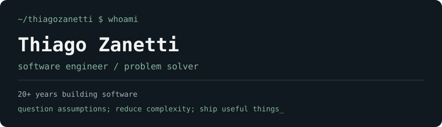

  

  &nbsp;

I'm a full-stack software engineer who's been building things for **20+ years**. Long enough to have seen a few revolutions, a lot of renamed ideas, and more frameworks than anyone reasonably needs.

I'm still curious. I still enjoy a difficult bug. And I still think the most useful question in engineering is **"why?"**

My primary stack revolves around TypeScript, JavaScript, Node.js, React, and Angular, but my experience goes well beyond frameworks. I've worked extensively with APIs, databases, asynchronous processing, CI/CD, and the less glamorous parts of building software that stays reliable in production.

I've also worked with Python across Django, Flask, Bottle, and FastAPI. While it's not my primary stack these days, it's still part of my toolbox. More recently, I've been exploring Go and Rust, expanding my understanding of different programming paradigms and approaches to solving problems.

I don't collect technologies for the sake of it, and I'm not particularly loyal to any stack. I prefer understanding the problem first, then choosing the tools that actually make sense.

### Things I reach for

<h4>Languages & Runtimes</h4>

  
  
  
  
  

<h4>Frontend & Backend</h4>

  
  
  
  
  
  
  
  
  
  

<h4>Data, APIs & Messaging</h4>

  
  
  
  
  
  
  
  

<h4>Infrastructure, Quality & Observability</h4>

  
  
  
  
  
  
  
  
  
  

<h4>Currently Exploring</h4>

  
  

### Out in the open

**[react-intl-currency-input](https://github.com/thiagozanetti/react-intl-currency-input)**

Currency input for React using JavaScript's internationalization APIs. Because money and locale formatting shouldn't require a fight with your input field.

**[@teelabs/native-utility-pack](https://www.npmjs.com/package/@teelabs/native-utility-pack)**

A collection of reusable React Native utilities. Small pieces that save repeated work.

There is more in the [repositories tab](https://github.com/thiagozanetti?tab=repositories). Browse around; the code is more interesting than a wall of badges.

### Currently poking at

- **AI-native engineering:** Spec-driven development, multi-agent orchestration, context engineering, automated validation, and adversarial code reviews. Using AI to accelerate delivery without compromising architecture, code quality, or human accountability.
- **Developer tools:** reusable packages, JavaScript runtimes, and ways to remove friction from everyday work.
- **Personal experiments:** data visualization, health tracking, and connected devices.

### Things experience has taught me

> Complexity is easy to add and expensive to remove.
>
> A best practice without context is just somebody else's preference.
>
> Being experienced doesn't mean being right. It should mean getting better at noticing when you're wrong.

I like people who can explain their decisions, challenge mine, and change their minds when the evidence changes. I'm not interested in arguing for sport; I am interested in understanding why we're building something in the first place.

Away from the keyboard, I'm a proud dad, and sometimes I sing while playing my acoustic guitar. I have a weakness for good music and questions with no obvious answer.

---

**Open to remote engineering roles, interesting collaborations, and selected freelance projects.**

Other than this GitHub page, you cna find me on [LinkedIn](https://www.linkedin.com/in/thiagozanetti) and through [email](mailto:thiago.project@gmail.com).

*Feel free to question me. I'll probably question you too.*
